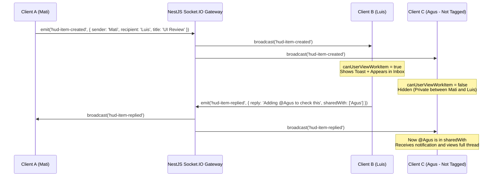

# RFC — HUD v3: Threaded Replies, Per-User Privacy (`@tag`), Auto-Close Overlays, and Next-Phase Room Creation & Layout Molding Plan

- **Status**: HUD v3 Implemented on `feat/ui-dashboard` · Next-Phase Room & Start Menu Plan Specified
- **Author**: Mati ([tracker-mati.md](../../changelogs/tracker-mati.md))
- **Related Documents**:
  - [Frontend UI PRD (v2)](./prd-frontend-ui.md)
  - [Functional Requirements Specification (ERS)](../functional-requirements.md)
  - [User Stories](../user-stories.md)
  - [Master Document](../../master-document.md)
  - [Rooms and Permissions Rules](../../rules/rooms-and-permissions.md)
  - [Security Rules](../../rules/security.md)
  - [Tasks and Productivity Rules](../../rules/tasks-and-productivity.md)
  - [UI Consistency and Accessibility Rules](../../rules/ui-and-accessibility.md)
  - [Movement and Object Interaction Rules](../../rules/movement-and-interactions.md)
  - [Art Direction Rules](../../rules/art-direction.md)

---

## 1. Executive Summary

This RFC documents two complementary deliverables for the 3D/2D virtual office workspace:

1. **Part I — Implemented in `feat/ui-dashboard` (HUD v3 Interactive Threads & Privacy)**:
   - **Live Server Presence Roster**: The top-right island displays exclusively teammates connected in real time via Socket.IO (`room-players`), eliminating static placeholder names.
   - **Auto-Closing Interactive Dropdowns & Notifications**: Incoming toast notifications (`TaskNotificationBanner`, `6000ms`) and top-island dropdowns (`TopNavbarIslands`, `8000ms`) automatically close after inactivity and pause while hovered or focused.
   - **Collapsible, Minimizable, and Expandable Gmail-Style Inbox**: `TaskHudMenu` supports a **Minimized Bottom-Dock Mode** (`.hud-inbox-minimized-dock`), global **Expand / Collapse all threads**, and instant search.
   - **Threaded Replies (`Replies`)**: Every task and note supports real-time conversational replies (`hud-item-replied`) with one-click `@username` mention chips.
   - **Strict Per-User Privacy (`@tag` & `sharedWith`)**: Individual tasks and notes are strictly private between their `sender` and `recipient`. Other connected users cannot view them or receive notifications unless explicitly tagged with `@username` or added via **Compartir con...** (`sharedWith`).

2. **Part II — Next Improvement Plan: Improved Initial Start Menu, Public/Private Room Creation & Custom 3D Room Layout Molding**:
   - **Pillar 1 — Improved Initial Start / Lobby Menu (`RF-AUT-002`, `RF-OFI-001`..`003`, `RF-HAB-009`, `RF-MUN-010`)**: Upgrade the initial `.join-modal` into a structured Workspace Start Menu where users identify themselves, select their office (own or invited, with role badge), inspect available Public and Private rooms with live occupancy counts, and either enter a room or launch the Room Creator.
   - **Pillar 2 — Creation of Public & Private Rooms with Server-Side Security (`RF-HAB-001`..`011`, `RN-03`..`RN-12`, `RN-16`)**: Allow `Dueño` and `Administrador` to create up to **5 additional rooms per office** (`RN-05`) beyond the non-deletable Main Room (`Habitación principal`, `RN-04`), configuring each room as **Public** (open to all office members) or **Private** (restricted to `Dueño`, `Administrador`, assigned `Líder`, and explicitly authorized members), enforced server-side (`401`/`403` + immediate live eviction to the Main Room on access revocation per `RN-12`).
   - **Pillar 3 — Custom Room Design & Interactive Layout Molding on Creation (`RF-MUN-001`, `RF-MUN-005`, `RF-OBJ-001`..`007`)**: Allow `Dueño` and `Administrador` to mold a room's design and interactive stations upon creation or edition—selecting dimensions, warm isometric palette presets, and custom placement/rotation of interactive 3D/2D objects (Kanban Board, Noticeboard, Portal Doorway, Team Counter, Waiting Sofa, Bot Station) with automatic 3D collision recalculation and live multiplayer synchronization.

---

## 2. Part I — Implemented Architecture (`feat/ui-dashboard`)

| Area | Technical Decision | Files Involved |
|---|---|---|
| **Individual Privacy & `@tags`** | [`canUserViewWorkItem`](../../src/features/tasks/task-types.ts) filters both the inbox and incoming notifications. Returns `true` only when the active user is `sender`, `recipient`, listed in `sharedWith`, mentioned via `@username` in description/replies, or when the recipient is the group channel (`Equipo Recepción`). | [`task-types.ts`](../../src/features/tasks/task-types.ts), [`TaskHudMenu.tsx`](../../src/features/tasks/TaskHudMenu.tsx), [`ReceptionPreview.tsx`](../../src/features/world/ReceptionPreview.tsx) |
| **Threaded Replies (`Replies`)** | Each `HudWorkItem` maintains `replies: HudItemReply[]`. Submitting a reply or clicking an `@teammate` chip emits `hud-item-replied` over Socket.IO and automatically appends newly mentioned users to `sharedWith`. | [`TaskHudMenu.tsx`](../../src/features/tasks/TaskHudMenu.tsx), [`rooms.gateway.ts`](../../server/src/rooms/rooms.gateway.ts) |
| **Auto-Close Interactive Overlays** | `TaskNotificationBanner` auto-closes after `6000ms` and `TopNavbarIslands` menus after `8000ms`. Both pause their timers on `onMouseEnter` / `onFocus` for keyboard and pointer accessibility. | [`TaskNotificationBanner.tsx`](../../src/features/tasks/TaskNotificationBanner.tsx), [`TopNavbarIslands.tsx`](../../src/features/tasks/TopNavbarIslands.tsx) |
| **Gmail-Style Collapse / Expand / Minimize** | `TaskHudMenu` supports 3 states: **Closed**, **Minimized Bottom-Dock** (`.hud-inbox-minimized-dock` so users can walk through the 3D scene without losing inbox context), and **Expanded Fixed Modal** with global **Expand/Collapse all threads**. | [`TaskHudMenu.tsx`](../../src/features/tasks/TaskHudMenu.tsx), [`styles.css`](../../src/app/styles.css) |
| **2D Interactive Controls** | 1) Interactive **Presence Status Selector** (`Disponible`, `Enfocado / No molestar` which mutes incoming popups, `En revisión`). 2) Direct 2D shortcut to the **Reception Noticeboard** (`📌 Cartelera`). 3) Instant search and inline member sharing per row. | [`TopNavbarIslands.tsx`](../../src/features/tasks/TopNavbarIslands.tsx), [`ReceptionPreview.tsx`](../../src/features/world/ReceptionPreview.tsx) |

### Privacy and Threaded Reply Flow

---

## 3. Part II — Next Improvement Plan: Start Menu, Public/Private Rooms & Custom Room Molding

This section specifies the exact architecture, user flows, requirement traceability, and security boundaries for the next improvement phase. Scope is strictly bounded to three pillars:

1. **Improving the Initial Start / Lobby Menu**
2. **Creating Public and Private Rooms with Server-Side Security**
3. **Designing and Molding Custom Room Layouts on Creation to Visualize 3D/2D Interactions**

---

### 3.1 Step 1 — Improved Initial Start / Entry Menu (`WorkspaceStartMenu`)

- **Requirements & Stories Covered**: [`RF-AUT-002`](../functional-requirements.md#rf-aut-002--inicio-de-sesión), [`RF-OFI-001`](../functional-requirements.md#rf-ofi-001--creación-automática-de-la-oficina-propia), [`RF-OFI-002`](../functional-requirements.md#rf-ofi-002--lista-de-oficinas-del-usuario), [`RF-OFI-003`](../functional-requirements.md#rf-ofi-003--ingreso-a-una-oficina), [`RF-HAB-001`](../functional-requirements.md#rf-hab-001--habitación-principal), [`RF-HAB-009`](../functional-requirements.md#rf-hab-009--cambio-de-habitación), [`RF-MUN-010`](../functional-requirements.md#rf-mun-010--lista-de-presencia), [`HU-OFI-002`](../user-stories.md), [`HU-OFI-003`](../user-stories.md).
- **Problem Addressed**: The current `.join-modal` in [`ChatOverlay.tsx`](../../src/features/network/ChatOverlay.tsx) only asks for a display nickname and places every user into a single default room without showing office context, room privacy, or available spaces.

#### Detailed Step-by-Step User Flow
1. **Identity & Session Context (`RF-AUT-002`, `RF-AUT-007`)**:
   - The user enters or confirms their visible display name and sees their active session status and role badge (`Dueño`, `Administrador`, `Líder`, or `Miembro`).
2. **Office Selector (`RF-OFI-001`, `RF-OFI-002`, `RN-01`)**:
   - Displays the user's **own office** (created automatically upon registration per `RN-01`, where the user is `Dueño`) alongside **invited offices** (where the user is `Administrador` or `Miembro`).
   - Deactivated offices (`baja lógica` per `RN-14`) are hidden from regular members and shown with a recovery countdown only to their `Dueño` (`RF-OFI-015`).
3. **Interactive Room Directory (`RF-OFI-003`, `RF-HAB-001`, `RF-HAB-009`, `RF-MUN-010`)**:
   - Lists all rooms belonging to the selected office:
     - **Main Room (`Recepción Principal`)**: Marked as `Principal · Pública`. Always accessible to all members of the office (`RN-04`).
     - **Additional Rooms (up to 5 per office, `RN-05`)**: Marked with their visibility pill (`🌐 Pública` or `🔒 Privada`), custom theme badge, number of molded interactive 3D stations, and **live connected members list** (`RF-MUN-010`).
   - **Privacy & Presence Boundary (`RF-MUN-010` criterion 4 & `RN-03`)**:
     - If an additional room is `Privada` and the user lacks access, the card shows *who* is currently connected inside (`RF-MUN-010`) but disables entry (`🔒 Sin acceso`) and never exposes the room's tasks, notes, announcements, or chat history (`RN-03`, `RF-HAB-011`).
4. **Entry & Creation Actions**:
   - **Enter Selected Room (`Ingresar a la sala`)**: Requests server-verified admission (`join-room`) into the chosen accessible room (defaulting to the Main Room per `RF-OFI-003` criterion 1).
   - **Create & Mold New Room (`+ Crear y diseñar sala`)**: Visible to `Dueño` and `Administrador` (`RF-HAB-002`) when the office has fewer than 5 additional rooms (`RF-HAB-003`). Opens the Room Creator & Layout Builder directly from the start menu or from the in-game top navigation island.

---

### 3.2 Step 2 — Creation of Public & Private Rooms and Server-Side Security

- **Requirements & Rules Covered**: [`RF-HAB-001`](../functional-requirements.md#rf-hab-001--habitación-principal) through [`RF-HAB-011`](../functional-requirements.md#rf-hab-011--verificación-de-acceso-en-el-servidor), `RN-03` through `RN-12`, `RN-16`, [`rooms-and-permissions.md`](../../rules/rooms-and-permissions.md), [`security.md`](../../rules/security.md).

#### Room Visibility & Role Matrix

| Room Category | Access Boundary | Who Can Create / Delete | Who Can Manage Member Access & Leaders |
|---|---|---|---|
| **Main Room (`Habitación principal`)** | **Public to all office members** (`RN-04`). Every office member enters without explicit room grant (`RF-HAB-001`). | Created automatically with the office (`RF-OFI-001`). **Cannot be deleted** (`RF-HAB-001` #3, `RF-HAB-005` #3). | Access cannot be revoked for active office members (`RF-HAB-001` #3). `Dueño` and `Administrador` can customize its layout. |
| **Public Additional Room (`Sala Pública`)** | **Accessible to all active members of the office**. Counts toward the 5-room limit (`RN-05`). | `Dueño` and `Administrador` (`RF-HAB-002`, `RF-HAB-005`). `Líder` and `Miembro` receive `403`. | `Dueño` and `Administrador` assign `Líderes` (`RF-HAB-008`) and can switch visibility to Private at any time. |
| **Private Additional Room (`Sala Privada`)** | **Restricted (`RN-03`, `RF-HAB-002`, `RF-HAB-006`)**: Only `Dueño`, `Administrador` (`RN-07`), assigned room `Líderes`, and office members explicitly granted access (`allowedUsers`) can enter or read resources. | `Dueño` and `Administrador` (`RF-HAB-002`, `RF-HAB-005`). `Líder` and `Miembro` receive `403`. | `Dueño` and `Administrador` manage all rooms and leaders (`RF-HAB-007`, `RF-HAB-008`); a room `Líder` can grant/revoke member access **only for their own room** and **only to existing office members** (`RN-10`, `RN-11`, `RF-HAB-006`). |

#### Security & Data Integrity Rules (`rules/security.md` & `rules/rooms-and-permissions.md`)
1. **Strict Quota & Uniqueness Validation (`RF-HAB-002`, `RF-HAB-003`, `RN-05`, `RN-17`)**:
   - Room names must be non-empty and unique within the same office (`RF-HAB-002` criterion 3).
   - An office can have at most **5 additional rooms** beyond the Main Room (`RN-05`). Attempting to create a 6th additional room is rejected by the server (`RF-HAB-003` criterion 1). Deleting an additional room frees the quota slot (`RF-HAB-003` criterion 2).
2. **Server-Side Authorization on Every Operation (`RF-HAB-011`, `RN-16`)**:
   - Hiding a button or room card in the React UI is **not** authorization ([`security.md`](../../rules/security.md#identity-permissions-and-data)).
   - Every HTTP request and Socket.IO / realtime command (`join-room`, `create-room`, `update-room`, `delete-room`, `player-move`, `chat-message`, `hud-item-*`) validates on the server:
     - **Authentication (`401`)**: Requests without a valid session/identity are rejected with `401`.
     - **Authorization (`403`)**: Requests from users who do not belong to the office or lack access to the target Private Room are rejected with `403` (`room-access-denied`), without leaking whether foreign office resources exist (`RF-HAB-011` criterion 2) and leaving persisted state unchanged ([`rooms-and-permissions.md`](../../rules/rooms-and-permissions.md#ownership-and-authorization)).
3. **Immediate Live Eviction & State Isolation on Access Loss (`RF-HAB-010`, `RN-12`)**:
   - If a user's access to a Private Room is revoked while they are connected inside that room (`RF-HAB-006` criterion 6), or if the room is deleted (`RF-HAB-005` criterion 2):
     1. The server immediately removes their socket from the private room channel, moves their live session to the **Main Room (`Habitación principal`)**, and emits `room-evicted`.
     2. The frontend immediately clears the evicted room's board, noticeboard, meetings, and chat history from memory so private data never leaks across rooms (`RN-12`, [`rooms-and-permissions.md`](../../rules/rooms-and-permissions.md#observable-acceptance-checks)).
     3. Any tasks assigned to the evicted user inside that room are marked as **Orphaned (`Huérfana`)** (`RF-TAR-009`, `RN-12`) until reassigned by an authorized member.

---

### 3.3 Step 3 — Custom Room Design & Interactive Layout Molding on Creation ("Moldear la sala a gusto")

- **Requirements & Rules Covered**: [`RF-MUN-001`](../functional-requirements.md#rf-mun-001--escena-isométrica-de-la-habitación), [`RF-MUN-005`](../functional-requirements.md#rf-mun-005--colisiones-y-límites-del-espacio), [`RF-OBJ-001`](../functional-requirements.md#rf-obj-001--interacción-con-un-objeto) through [`RF-OBJ-007`](../functional-requirements.md#rf-obj-007--personalización-de-la-habitación), `RN-20`, [`art-direction.md`](../../rules/art-direction.md), [`movement-and-interactions.md`](../../rules/movement-and-interactions.md).

#### How the Room Layout Builder Works Step by Step

1. **Step 3A — Selecting Room Dimensions & Warm Isometric Palette Preset**:
   - During room creation (or when clicking **"🎨 Moldear sala"** in an existing room as `Dueño`, `Administrador`, or room `Líder`), the designer selects:
     - **Architectural Theme Preset** (honoring the warm editorial isometric palette in [`art-direction.md`](../../rules/art-direction.md)):
       - `warm-reception` (*Roble Cálido Editorial* — `#FFF0D8` key light, `#D8B790` floor, `#62CFC7` accents)
       - `studio-teal` (*Estudio Creativo Turquesa* — `#E0F7F5` key light, `#E4D2BA` floor, `#62CFC7` accents)
       - `executive-amber` (*Sala Ejecutiva Ámbar* — `#FDEFD4` key light, `#A66B43` floor, `#D9A520` accents)
       - `focus-lavender` (*Laboratorio Focus Lavanda* — `#EFEBF9` key light, `#D8B790` floor, `#B5A7D6` accents)
2. **Step 3B — Molding Interactive 3D/2D Stations on the Floorplan Blueprint (`RF-OBJ-002`, `RF-OBJ-003`, `RF-OBJ-005`, `RF-OBJ-007`)**:
   - An interactive 2D top-down blueprint grid (`X: -4.5 .. 4.5`, `Z: -3.8 .. 3.8`) lets the creator place, move, rotate (`0°`, `90°`, `180°`, `270°`), or toggle modular 3D interactive objects:

   | Object Type (`MoldedObjectKind`) | 3D Visual Station | Triggered 2D Interaction (`RF-OBJ-001`, `RF-OBJ-002`) | Permission Required (`RF-OBJ-004`, `RN-20`) |
   |---|---|---|---|
   | `task-board` | **3D Kanban Corkboard Stand** | Opens the room's Task Board / HUD Inbox (`RF-OBJ-002` #1). | Room access (`RF-TAR-001`); column configuration requires `Dueño`/`Admin`/`Líder` (`RF-TAR-007`). |
   | `noticeboard` | **3D Noticeboard & Calendar Panel** | Opens the room's persistent Noticeboard and Meetings panel (`RF-OBJ-002` #2). | Room access to read (`RF-CAR-001`); publishing announcements/meetings requires `Dueño`/`Admin`/`Líder` (`RF-CAR-002`, `RF-CAR-005`). |
   | `portal-doorway` | **3D Interior Portal Doorway** | Opens the Room Switcher modal showing accessible rooms (`RF-OBJ-002` #3, `RF-HAB-009`). | Entry into target room validated server-side (`RF-HAB-011`). |
   | `bot-station` | **3D AI Assistant Terminal** | Opens the read-only Bot & Daily Briefing dialog (`RF-OBJ-002` #4, `RF-BOT-001`..`008`). | Strictly read-only (`RN-18`); summarizes only rooms the user is authorized to access (`RF-BOT-003`). |
   | `team-table` | **3D Collaborative Team Desk** | Opens the quick task/note composer pre-addressed to the room's team (`RF-TAR-002`). | Room access (`RF-TAR-002`). |
   | `waiting-seat` | **3D Lounge Sofa** | Moves the avatar to the lounge area and switches presence status to `En revisión / Pausa` (`RF-MUN-014`). | Room access. |

3. **Step 3C — Automatic Collision Envelope & Spawn Protection (`RF-MUN-005`)**:
   - Placing or moving any 3D station on the blueprint grid automatically computes its Axis-Aligned Bounding Box (`Rectangle`) and merges it into the room's navigation obstacle list ([`reception-layout.ts`](../../src/features/world/reception-layout.ts)).
   - The builder prevents placing obstacles over the entry spawn point `(0, 2)` or blocking the doorway threshold, preserving the `1.1` avatar collision radius (`receptionAvatarRadius`) so avatars smoothly stop or slide around custom-placed objects (`RF-MUN-005`).
4. **Step 3D — Live 3D Rendering & Multiplayer Synchronization (`RF-OBJ-005`)**:
   - Saving the custom design persists the room's `layout` on the server and broadcasts `room-layout-updated` to all connected clients in that room, immediately updating the 3D scene meshes, floating station labels, and raycast hitboxes without reloading.

```mermaid
flowchart LR
    Lobby["1. Improved Start Menu<br/>(Identity, Office & Room Directory)"] --> Action{"User Choice"}
    Action -->|"Select Accessible Room"| Guard["Server Authorization Guard<br/>(RF-HAB-011 / RN-16: 401 & 403)"]
    Action -->|"+ Create & Mold Room<br/>(Owner / Admin, max 5)"| Studio["2. Room Creator & Molding Studio"]
    Studio --> Privacy["Configure Visibility:<br/>Public vs. Private + Leaders & Members"]
    Privacy --> Blueprint["3. Mold 3D Layout:<br/>Theme Preset + Place & Rotate 3D Objects"]
    Blueprint --> Persist["Save & Broadcast Layout<br/>(Update 3D Colliders & Hitboxes)"]
    Persist --> Guard
    Guard -->|"Authorized"| Enter3D["Enter Custom 3D Room<br/>& Click Molded 3D Objects"]
    Guard -->|"Unauthorized / Revoked"| Evict["Reject (403) or Evict to<br/>Main Room (RN-12)"]
```

---

## 4. Verification Checklist

- [x] `vitest run` passes all 15 test suites (94 tests, including [`TaskHud.test.tsx`](../../src/features/tasks/TaskHud.test.tsx)).
- [x] `tsc --noEmit` passes with zero type errors across `tsconfig.app.json` and `tsconfig.node.json`.
- [x] `vite build` produces a clean production bundle.
- [x] `python3 scripts/ci/check_docs.py` and `git diff --check` pass with zero documentation link or whitespace errors.
